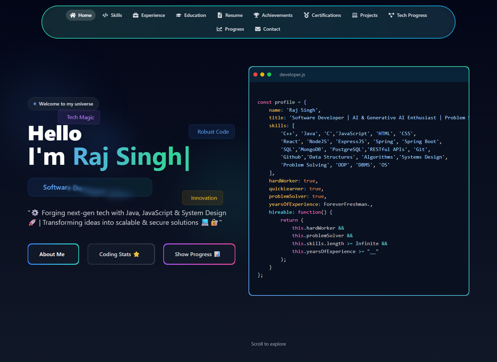
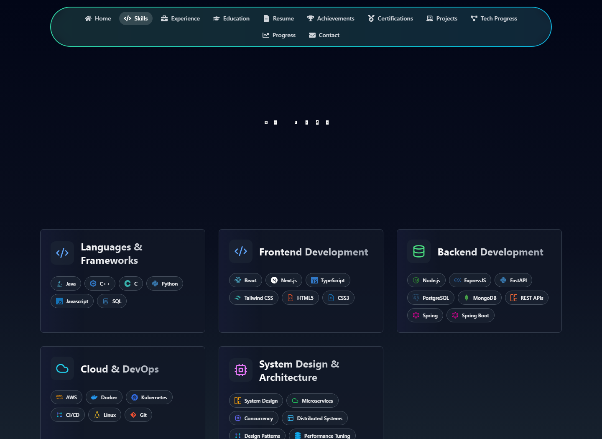
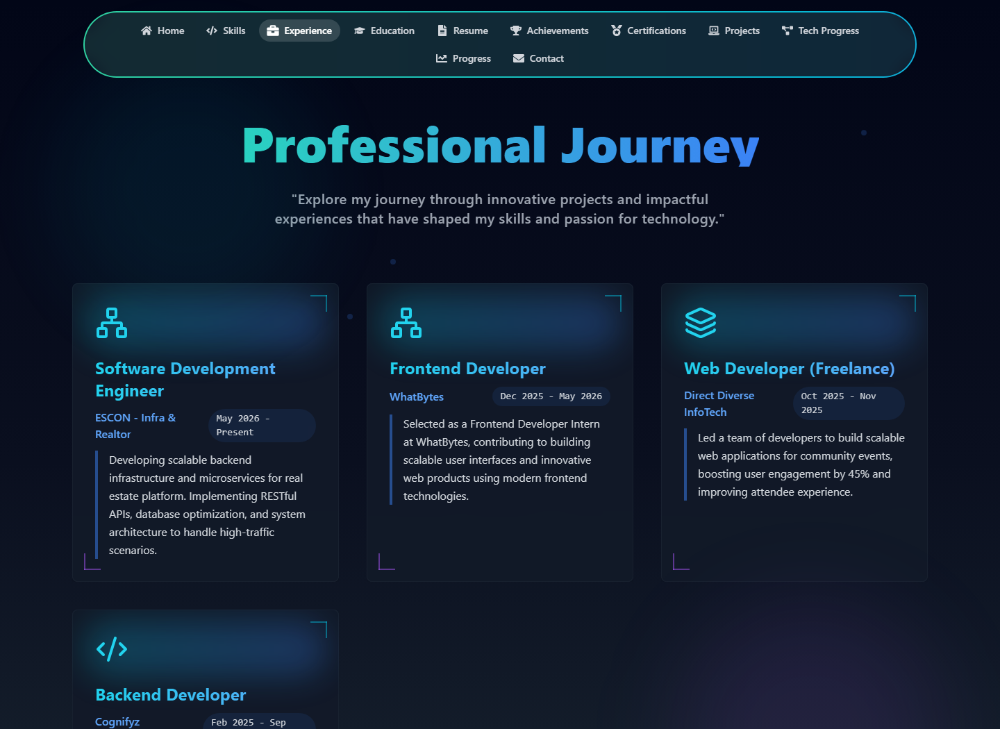
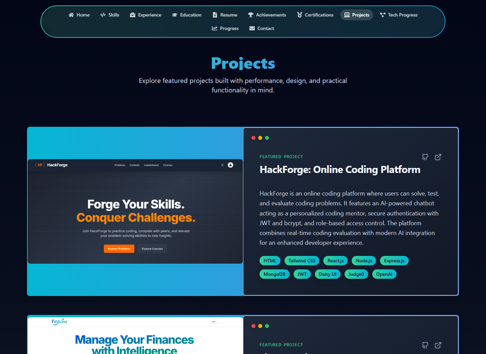
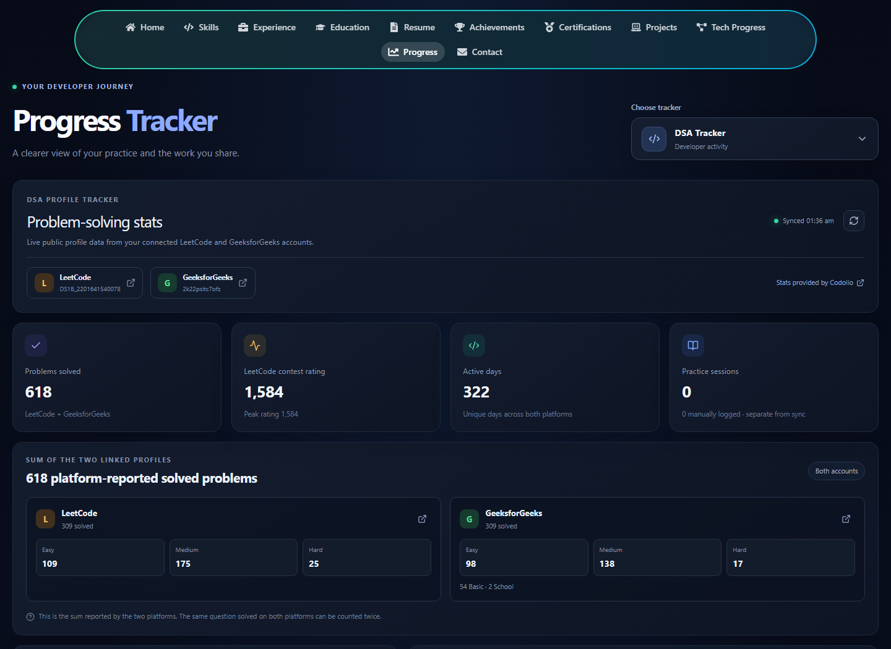
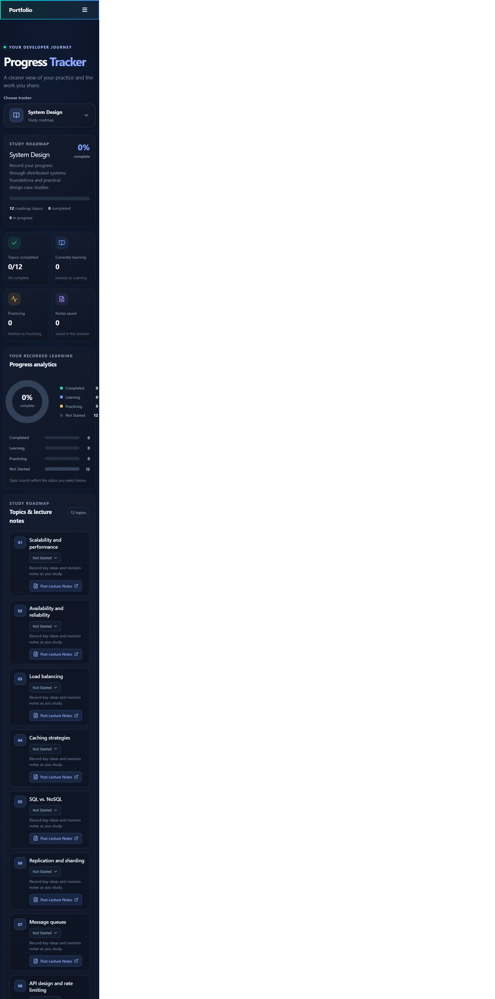
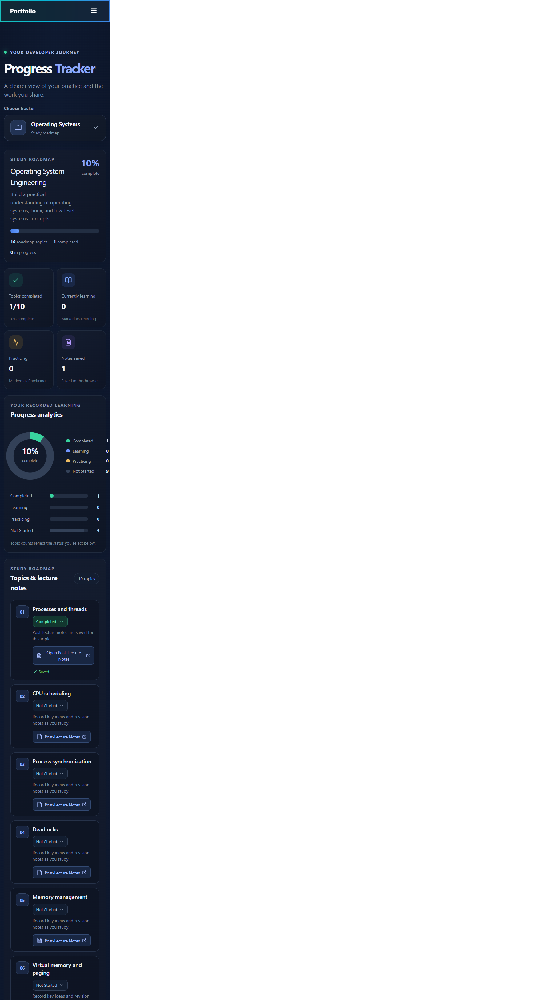
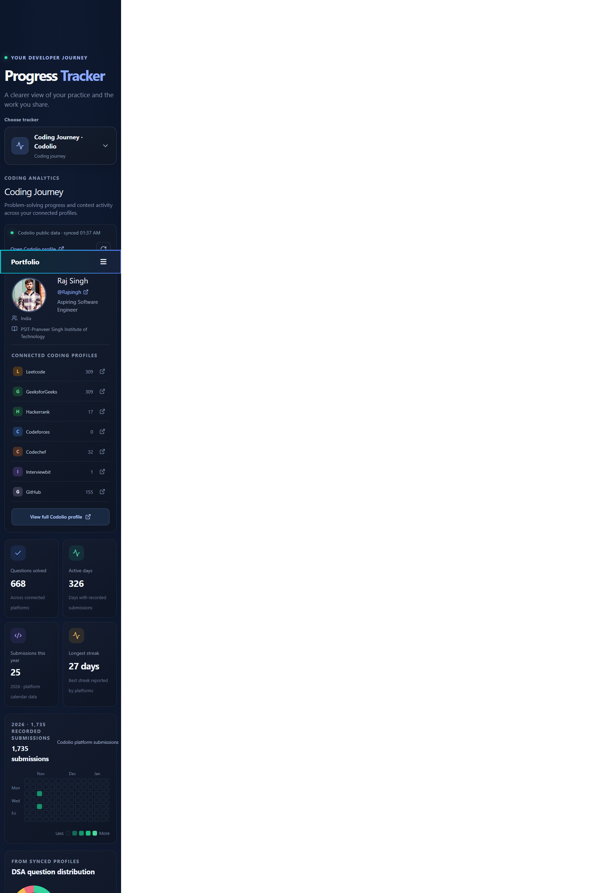

# Raj Singh — Developer Portfolio

A responsive React portfolio showcasing projects, skills, experience, education, achievements, and a developer progress dashboard.

## Portfolio previews

### Home



### Skills



### Experience



### Projects



### Progress — DSA



### Progress — System Design



### Progress — Operating Systems



### Progress — Coding Journey



## Progress dashboard

Open **Progress** from the portfolio navigation to explore:

- DSA totals and difficulty/topic details from the linked LeetCode and GeeksforGeeks profiles, provided through Codolio's public profile data.
- GitHub public profile, repository, and activity information.
- Subject roadmaps for Operating Systems, Java Backend, Microservices, Database Optimization, System Design, AWS, Kubernetes, and Kafka.
- Locally saved study progress, lecture notes, and manual DSA practice entries.
- Contribution/activity heatmaps and progress charts.

External profile statistics follow their provider's sync schedule. Manually entered notes and progress are stored in the current browser and are not synced between devices.

## Run locally

Requirements: Node.js and npm.

```bash
npm install
npm run dev
```

## Build and lint

```bash
npm run build
npm run lint
```

## Tech stack

- React 18
- Vite
- React Router
- Tailwind CSS
- Lucide and React Icons

## Deployment

The project builds as a Vite single-page application and can be deployed to Vercel or another static hosting provider. Configure the host to serve `index.html` as the fallback for application routes such as `/progress`.
